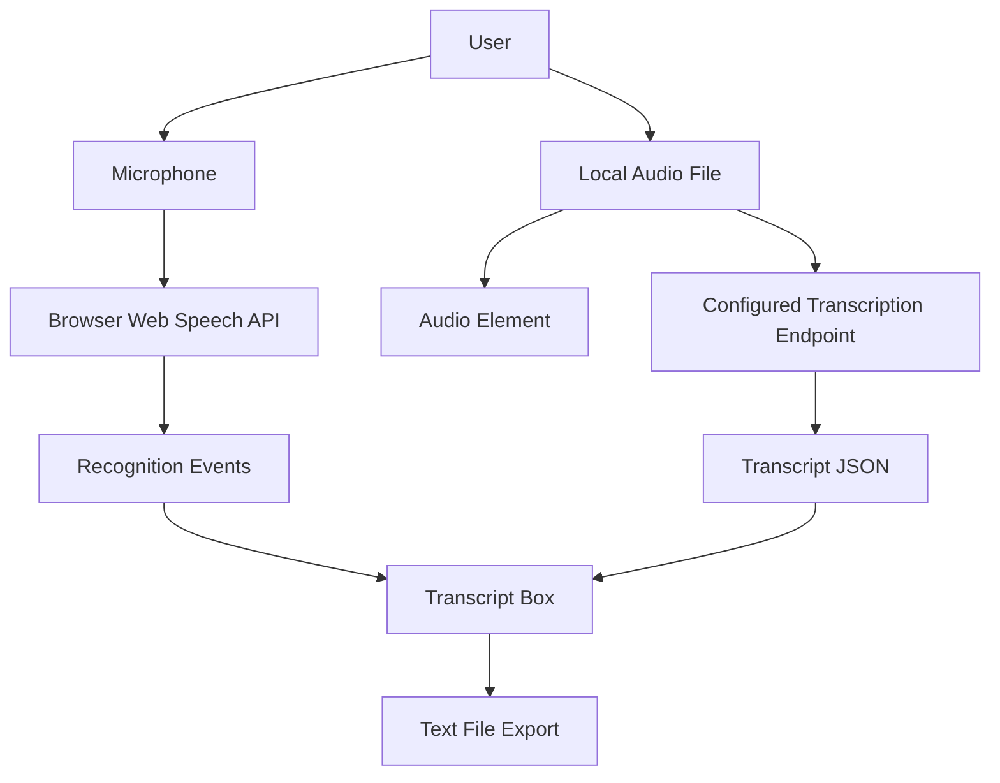

# Real-Time Transcription App

Browser application for real-time microphone transcription using the Web Speech API. It also supports local audio playback and an optional transcription endpoint for server-side processing.

## Features

- Live microphone transcription
- Interim and final recognition results
- Start and stop controls
- Local text display and automatic scrolling
- Export transcript to a `.txt` file
- Local audio file playback
- Configurable backend endpoint for audio transcription
- Browser capability detection

## Architecture



## Technology

- Vanilla JavaScript
- Vite
- Web Speech API
- Web Audio and HTML audio playback
- Fetch API
- Blob and download APIs
- CSS

## Requirements

- Modern Chromium-based browser or another browser supporting Web Speech API
- Microphone permission
- HTTPS or `localhost`
- Optional transcription backend for audio-file processing

## Installation

```powershell
npm install
npm run dev
```

Open the URL reported by Vite, normally `http://localhost:5173`.

## Production Build

```powershell
npm run build
npm run preview
```

## Audio File Endpoint

Copy `.env.example` to `.env.local`:

```dotenv
VITE_TRANSCRIPTION_ENDPOINT=http://localhost:3000/transcribe
```

The frontend sends a `multipart/form-data` request with a `file` field.

The endpoint should return:

```json
{
  "text": "Texto transcrito"
}
```

API keys and server credentials must stay in the backend. Never place a provider secret in a `VITE_*` variable.

## Project Structure

```text
index.html
src/
  main.js
  components/TranscriptBox.js
  utils/fileSaver.js
  css/style.css
public/
package.json
.env.example
```

## Browser Support

The Web Speech API is not implemented consistently across all browsers. In unsupported browsers, the application displays a browser compatibility message.

The quality of microphone recognition depends on browser support, language configuration, device, and network conditions.

## Known Limitations

- Microphone recognition is currently configured for `es-ES`.
- The application does not guarantee offline recognition.
- Audio-file transcription requires a separate backend service.
- The repository does not implement provider authentication or transcription backend code.
- The YouTube embed flow was removed because it was not a functional transcription source.
- Continuous recognition behavior varies across browsers.
- The interface has no automated tests yet.

## Security

- Do not add provider API keys to `src/main.js`.
- Do not store secrets in local storage or in Vite environment variables.
- Run audio transcription through a backend that validates file type and size.
- Request microphone permission only from trusted origins.
